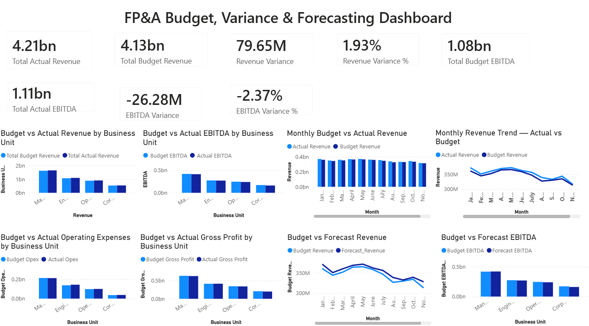

# FP&A Budget, Variance & Forecasting Dashboard

**Author:** Tanvi Kamat  
**Tools:** Microsoft Power BI, DAX, Microsoft Excel  
**Project Type:** Financial Planning & Analysis (FP&A)

## Project Overview

This project presents an interactive Financial Planning & Analysis (FP&A) dashboard developed using Microsoft Power BI. It focuses on financial performance monitoring, budget versus actual comparisons, variance analysis, and revenue and EBITDA forecasting.

The dashboard helps stakeholders evaluate financial performance across business units and identify differences between planned and actual results.

## Project Objectives

- Compare budgeted and actual revenue.
- Analyze EBITDA performance and profitability.
- Track operating expenses and gross profit against budget.
- Calculate financial variances and variance percentages.
- Compare budgeted revenue and EBITDA with forecast values.
- Present key financial performance indicators through interactive visualizations.

## Dashboard Preview

## Key Performance Indicators (KPIs)

- Total Actual Revenue
- Total Budget Revenue
- Revenue Variance
- Revenue Variance %
- Total Actual EBITDA
- Total Budget EBITDA
- EBITDA Variance
- EBITDA Variance %

## Dashboard Visualizations

The dashboard includes the following analyses:

1. Budget vs Actual Revenue by Business Unit
2. Budget vs Actual EBITDA by Business Unit
3. Monthly Budget vs Actual Revenue
4. Monthly Revenue Trend — Actual vs Budget
5. Budget vs Actual Operating Expenses by Business Unit
6. Budget vs Actual Gross Profit by Business Unit
7. Budget vs Forecast Revenue
8. Budget vs Forecast EBITDA by Business Unit

## Key Financial Insights

- Actual revenue exceeded budget, resulting in a positive revenue variance.
- EBITDA was below budget, indicating a shortfall against the planned profitability target.
- Revenue and EBITDA performance varied across business units.
- Operating expenses and gross profit were compared against budget to assess cost and profitability performance.
- Monthly revenue trends were analyzed to compare actual performance with planned revenue.
- Forecast revenue and EBITDA were compared with budget to support financial planning.

*Note: The insights above are based on the synthetic dataset created for this portfolio project.*

## Tools & Techniques

- **Power BI:** Dashboard development and financial data visualization
- **DAX:** KPI calculations, financial variance measures, and percentage calculations
- **Microsoft Excel:** Dataset preparation and data organization
- **Financial Analysis:** Budgeting, variance analysis, profitability analysis, and forecasting

## Dataset

The project uses a synthetic financial dataset containing monthly budget, actual, and forecast figures across business units and cost centers.

The dataset is intended for demonstration and portfolio purposes and does not represent actual company financial information.

## Files in This Repository

- `FPA_Budget_Variance_Forecasting_Dashboard.pbix` — Power BI dashboard file
- `FP&A_Budget_Variance_Forecasting_Data.xlsx` — Financial dataset
- `FPA_Budget_Variance_Forecasting_Dashboard.png` — Dashboard screenshot
- `README.md` — Project documentation

## Author

**Tanvi Kamat**

Mechanical Engineering graduate with interests in financial analytics, business intelligence, data visualization, and financial planning and analysis.

This project demonstrates the application of Power BI and DAX to financial reporting, budgeting, variance analysis, and forecasting.

